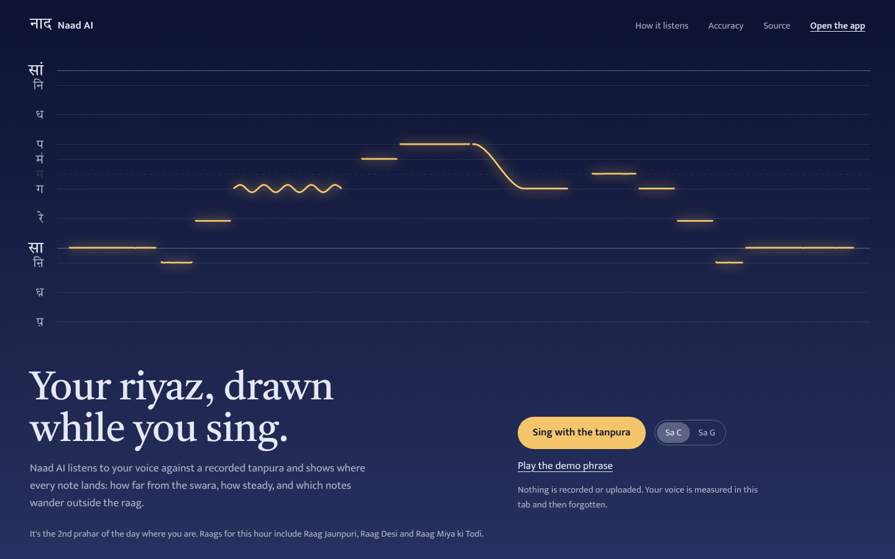
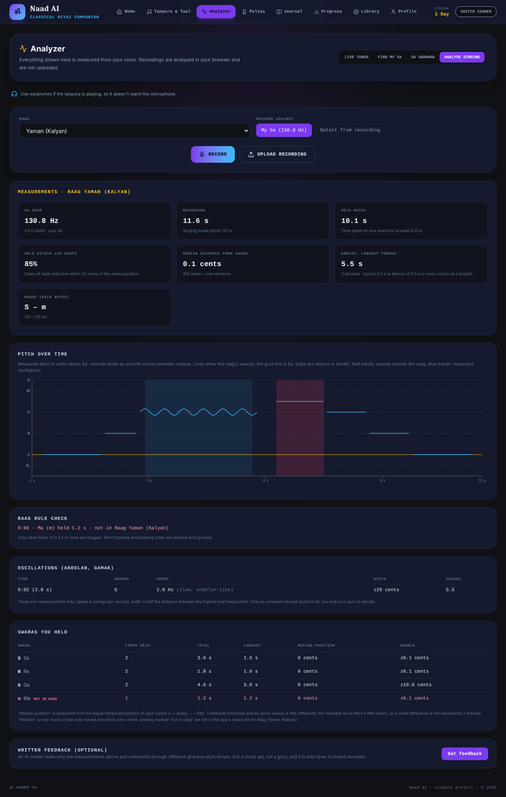
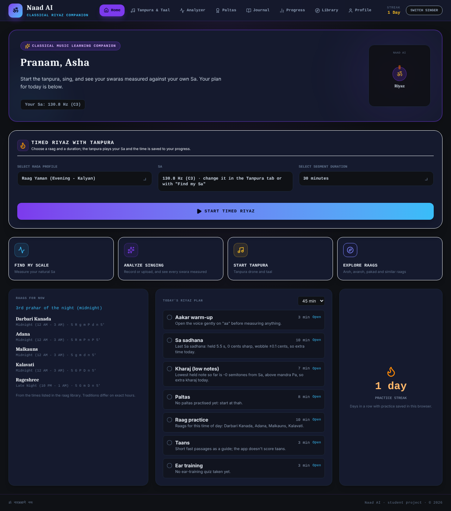
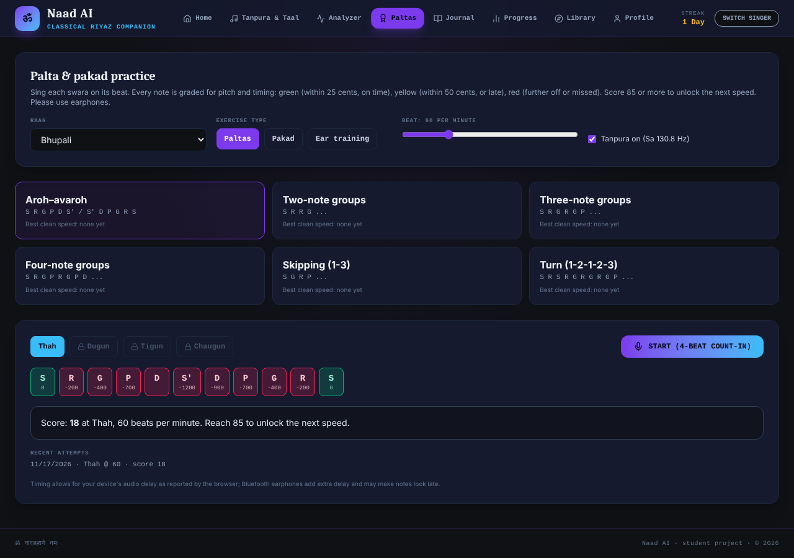
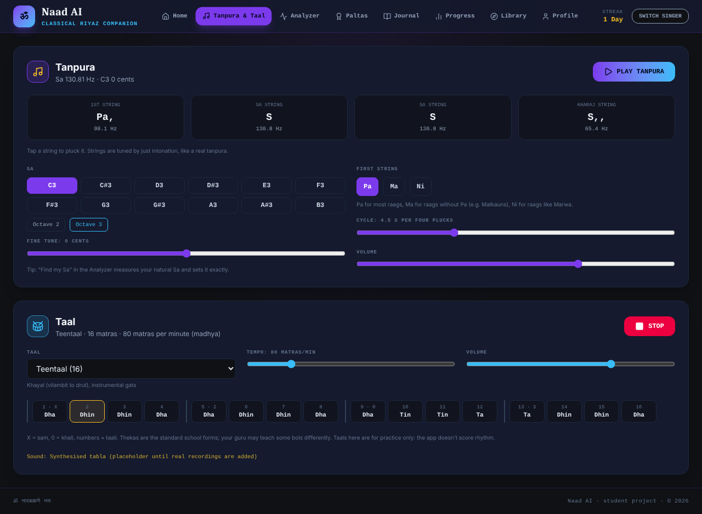
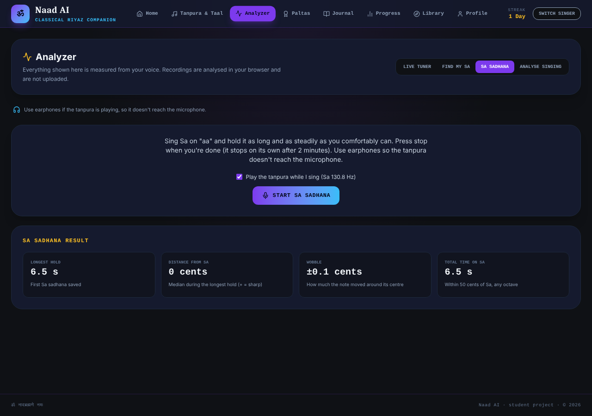
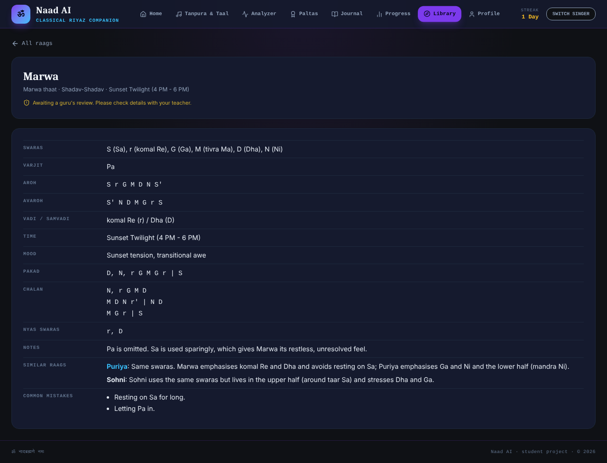
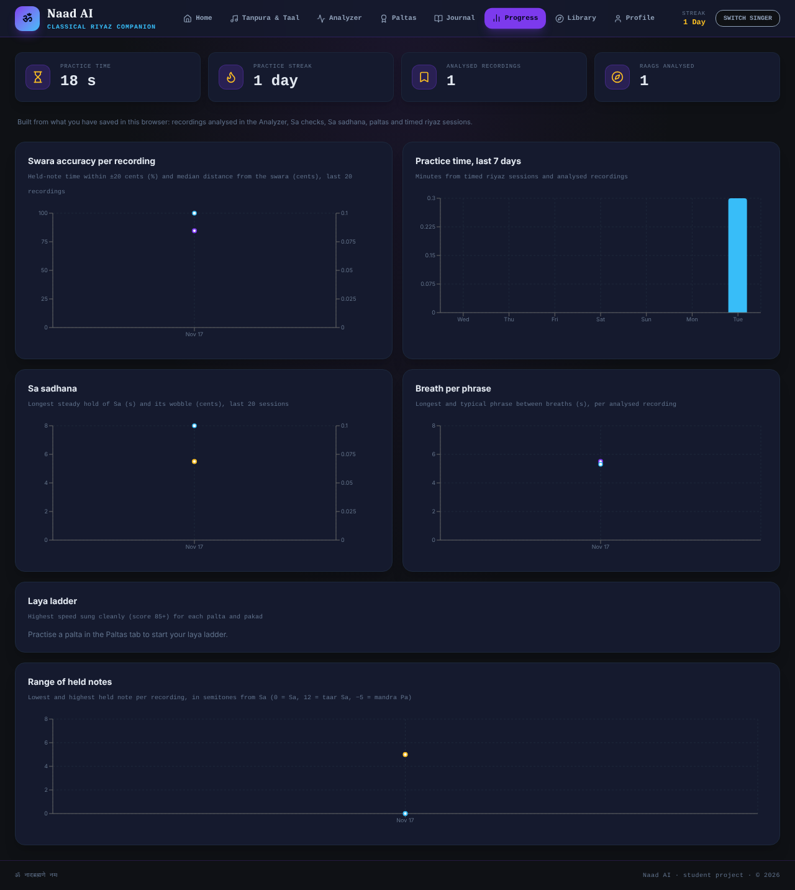

# Naad AI

[](https://github.com/aninditamondal303/naadai/actions/workflows/ci.yml)
[](https://aninditamondal303.github.io/NaadAI/)

A riyaz (practice) companion for Hindustani classical vocalists. It listens
while you sing and measures how you hold each swara against your own Sa,
plays the tanpura and taal itself, and turns your measurements into practice:
paltas across four layas, pakad practice, raag-grammar checks, ear training
and a daily plan.

You only need a laptop or phone microphone and earphones (earphones keep the
app's tanpura out of the microphone).

**Try it:** https://aninditamondal303.github.io/NaadAI/ (works in Chrome, Edge,
Firefox and Safari; allow the microphone when asked; use earphones)

The welcome page is itself an instrument: press **Sing with the tanpura** and
your voice is drawn live on the swara lines, or play the demo phrase and watch
it drawn as it plays. Its colours follow the sky at your local time, and it
suggests raags for the current prahar. The welcome page, singer picker and
menus are available in **English, हिन्दी and বাংলা** (the Hindi and Bengali
text awaits review by native speakers; the inner practice screens are still
in English).





### Learning a raag

For Yaman, Bhupali, Bhairav, Malkauns, Bhimpalasi, Bageshree, Marwa, Puriya
and Todi, the Library has alaap in three stages, a sargam geet and a bandish
in Bhatkhande-style swaralipi (in Devanagari, Bengali or S R G letters), with
what each is based on: the raag, the taal and its theka, the laya and the
form. Each can be played with a guide voice, the recorded tanpura and the
recorded tabla. These compositions and lyrics were written for this app to
follow each raag's rules (tests check every swara); they are not traditional
bandishes and await a guru's review. "Give me more" generates further sargam
and alaap phrases for any raag from its aroh and avaroh.

Practice also has basic paltas on the shuddha swaras (12 alankars), the same
patterns for every raag, and Sur milao: hear a swara, sing it, and see how
close you were. The app can be installed and works offline after the first
visit.

## Principles

- **Only real measurements.** Every number is measured from your voice. If
  something can't be measured reliably, the app doesn't show it. There is no
  random or sample data anywhere in the app.
- **Strict on raag rules, gentle on style.** A clearly held swara outside the
  raag is flagged with its time. A slower meend or a different ornament is
  your style: ornaments are measured, never judged.
- **Accuracy is measured and published.** See [Accuracy](#accuracy).

## Features

| Feature | What it does |
|---|---|
| **Live tuner** | Current swara and cents from your Sa |
| **Find my Sa** | Hold Sa for a few seconds; measures its pitch and wobble |
| **Sa sadhana** | Longest steady hold, distance from Sa and wobble, tracked over time |
| **Analyse singing** | Record or upload (analysed in the browser, never uploaded): held-note accuracy, per-swara position and wobble, range, breath per phrase, pitch curve on a sargam grid |
| **Raag rule checker** | Clearly held swaras outside the raag, with timestamps; short touches ignored |
| **Andolan and gamak** | Speed (Hz) and width (± cents) of each oscillation |
| **Automatic Sa detection** | Pitch histogram matched to the raag's swaras; says "unsure" instead of guessing |
| **Paltas with laya ladder** | Six paltas generated from each raag's aroh/avaroh; each note graded green/yellow/red for pitch and timing; thah → dugun → tigun → chaugun unlocks at 85 |
| **Pakad practice** | Note-by-note scoring of the raag's pakad |
| **Weak-swara paltas** | Built around the swaras your own measurements show are often off or unsteady |
| **Ear training** | Name the swara, or name the raag from a phrase (similar raags as distractors) |
| **Daily riyaz planner** | Aakar → Sa sadhana → kharaj → paltas → raag → taans → ear training; time adapts to your measurements and each step cites them |
| **Raags for now** | From the time of day (prahar) |
| **Tanpura and 10 taals** | Real tanpura and tabla recordings retuned to your Sa; Pa/Ma/Ni first string, fine tuning; Teentaal, Ektaal, Jhaptaal, Rupak, Dadra, Keherwa, Jhoomra, Tilwada, Chautaal, Deepchandi |
| **Raag library** | 45 raags; 9 with pakad, chalan, nyas swaras and comparisons with similar raags |
| **Profiles** | Several singers per device, no passwords, data stays in the browser; export/import |
| **Written feedback (optional)** | An AI model comments only on the measured numbers, through gharana-style lenses; never invents numbers or quotes real musicians |

| | | |
|---|---|---|
|  |  |  |
|  |  |  |

## Accuracy

All results are reproducible with one command each.

| What | Result | Test data | Command |
|---|---|---|---|
| Pitch within ±20 cents | 100% of sung frames; 0% false pitch in silence | 20 synthetic clips (Sa sadhana, aroh, kharaj, taar, andolan, gamak, meend, noise) | `npm run eval:pitch` |
| Sa detection within ±20 cents | 56 of 56 phrases (raag and voice type known) | 56 synthetic 20 s phrases, 4 raags × 14 Sa values | `npm run eval:sa` |
| Real voices | *Collecting recordings* | see [eval/recordings](eval/recordings/README.md) | `npm run eval:real` |

Synthetic clips are much easier than real singing, so these numbers are an
upper bound. The real-voice report is the one that counts; it uses
recordings sung over the app's own tanpura, so the true Sa is known exactly.

Pitch tracking uses the McLeod Pitch Method (implemented in
`src/analysis/pitch/mpm.ts`), chosen over YIN and plain autocorrelation by
the benchmark above.

## How it works

```
microphone / uploaded file
        │  (AudioWorklet: raw samples, browser voice processing off)
        ▼
src/analysis   pitch track (MPM, 100 readings/s) → held notes, Sa, swara stats,
               phrases, rule flags, oscillations          ← pure TypeScript, tested in Node
src/practice   paltas, note scoring, ear-training questions, weak swaras, planner
src/audio      tanpura engine, tabla theka player (audio-clock scheduling)
src/data       raag library, raag grammar, taals
src/lib        per-singer profiles and practice history (browser storage)
server.ts      serves the app; optional /api/feedback (numbers in, text out)
```

## Run locally

Requires Node.js 20 or later.

```bash
npm install
cp .env.example .env   # optional: add a Gemini API key for written feedback
npm run dev            # http://localhost:3000
```

| Command | |
|---|---|
| `npm test` | Unit tests (analysis, scoring, data consistency, profiles) |
| `npm run lint` | Type check |
| `npm run eval:pitch` / `eval:sa` / `eval:real` | Accuracy reports |
| `npm run raag:review` | Writes `docs/raag-review.md`, a checklist for a guru to verify the raag data |
| `npm run build` then `npm start` | Production build and server (uses `PORT` if set) |

## Credits

Tabla and tanpura recordings: [Naad](https://github.com/oormicreations/naad)
by Oormi Creations, MIT licence (see `public/samples/*/LICENSE`).

## Deploy

The website above is built automatically by `.github/workflows/pages.yml` on
every push to `main` and served by GitHub Pages from the `gh-pages` branch
(Settings → Pages → Deploy from a branch → `gh-pages`, `/ (root)`). It is a
static site, so the optional written feedback is switched off there.

To run with the server (and written feedback), any Node host works (for example Render or Railway): build command
`npm install && npm run build`, start command `npm start`, and optionally the
`GEMINI_API_KEY` environment variable for written feedback.

## Status and what's still needed

- **More tanpura recordings.** The app ships real tanpura and tabla
  recordings from the MIT-licensed [Naad](https://github.com/oormicreations/naad)
  project, but only one tanpura key (Sa–Pa, Sa = C). Ma/Ni tuning still uses a
  synthesised tanpura. See [docs/recording-guide.md](docs/recording-guide.md).
- **Raag data review.** Every raag entry is marked as awaiting a guru's
  review; see `docs/raag-review.md`.
- **Real-voice accuracy report.** See [eval/recordings](eval/recordings/README.md).
- **Real users.** Feedback from students at a music school.
