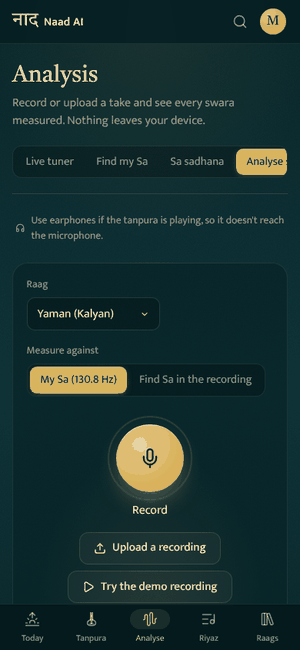
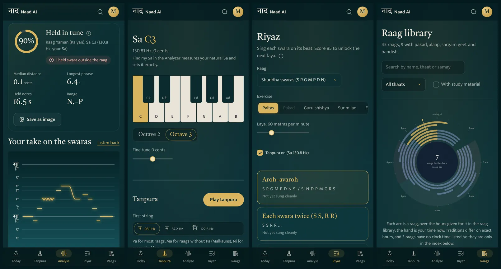
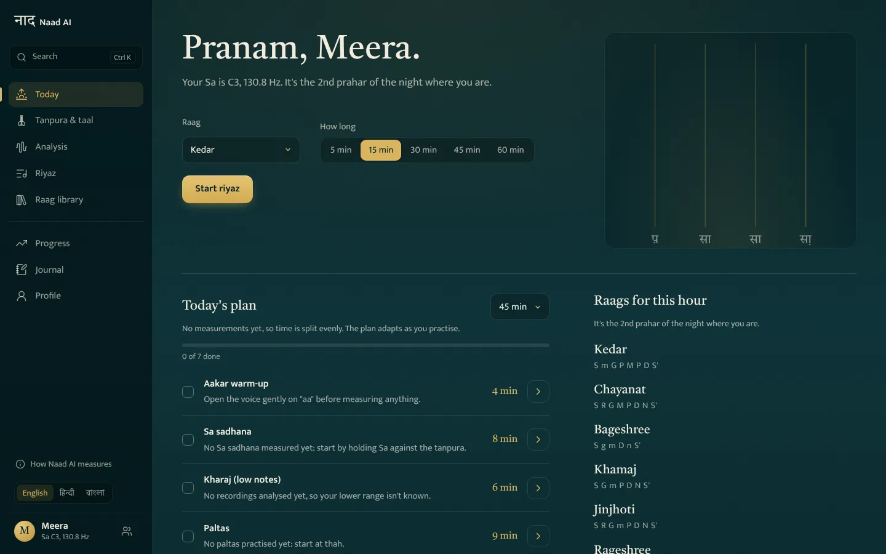
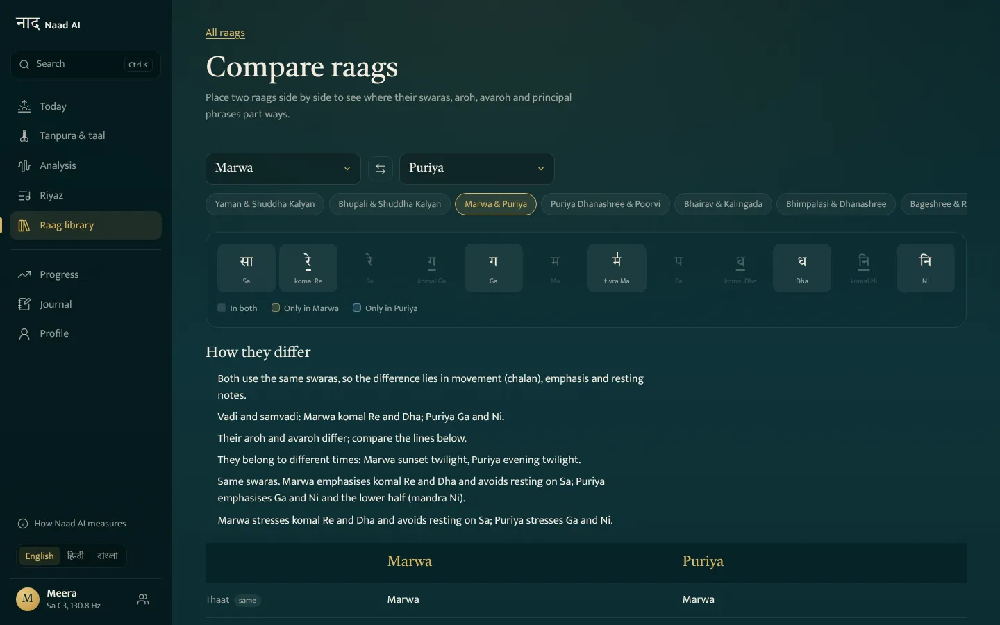

# Naad AI

[](https://github.com/aninditamondal303/naadai/actions/workflows/ci.yml)
[](https://aninditamondal303.github.io/NaadAI/)

> **For recruiters:** I built this solo and use it myself after 15+ years of Hindustani vocal training. It's a React + TypeScript app on the web and Android with real-time pitch analysis (92% of notes measured within 20 cents), 125 raags and 23 taals in three languages, 861 tests, CI/CD and a Lighthouse accessibility score of 100.

A riyaz (practice) companion for Hindustani classical vocalists. It plays a
recorded tanpura and tabla tuned to your Sa, listens while you sing, and
measures every swara: how close it sat to its place, how steadily it was held,
and whether it belonged to the raag. Everything runs on your device; nothing
is uploaded.

**Try it:** https://aninditamondal303.github.io/NaadAI/ (Chrome, Edge, Firefox
or Safari; allow the microphone; use earphones). **Android:**
[download the app](https://github.com/aninditamondal303/NaadAI/releases/latest/download/naad-ai.apk).
Available in **English, हिन्दी and বাংলা**.

<p align="center"></p>



### What a singer can do

- **Riyaz with the tanpura**, with lock-screen controls so it keeps playing when the phone sleeps; 23 taals with editable thekas, from Teentaal to Dhamar and Sultaal.
- **Analyse a take**: a summary of held-in-tune time, the raag rule check, range and breath, then the pitch line, each swara's position and wobble, the shruti view, andolan and gamak, and which raag it sounds like. While recording, the raag is recognised live.
- **Paltas and pakad** graded note by note across four layas; **Guru-shishya**, where the phrase can come from the app or from your own guru (the guru records once and sends a link; the guide follows the guru's own pitch line, meends included).
- **Learn a raag**: 125 raags with thaat, aroh, avaroh, vadi, samvadi, mukhya ang and vishranti sthan, alaap, sargam geet and bandish in swaralipi with **sing-along** at any laya, and **side-by-side comparison** of close raags.
- **Progress**: a weekly report (this week against last), swara tuning ring, streaks, journal, and a daily riyaz reminder (a notification in the Android app).
- **Quick find** (Ctrl/⌘ K) to reach any screen or raag.

| | |
|---|---|
|  |  |

How the measuring works, and how accurate it is, is written up in the
[case study](docs/case-study.md) and on the app's own
[method page](https://aninditamondal303.github.io/NaadAI/#how-it-works).

## Working in VS Code

Open the folder in VS Code and accept the recommended extensions. Tasks
(*Terminal → Run Task*) start the app, run the tests and run each benchmark;
*Run and Debug → Debug the app in Chrome* starts the dev server on port 3000
and opens it with breakpoints. To score pitch on a dataset with reference f0,
download it into `eval/datasets/` (ignored by git) and run the task
*Pitch accuracy on a dataset with reference f0*. On Windows PowerShell:

```powershell
New-Item -ItemType Directory -Force eval/datasets | Out-Null
Invoke-WebRequest "https://zenodo.org/record/5578807/files/vocadito.zip?download=1" -OutFile eval/datasets/vocadito.zip
Expand-Archive eval/datasets/vocadito.zip eval/datasets/vocadito
npm run eval:f0 -- eval/datasets/vocadito --name vocadito
```

## Principles

- **Only real measurements.** Every number is measured from your voice. If
  something can't be measured reliably, the app doesn't show it. There is no
  random or sample data anywhere in the app.
- **Strict on raag rules, gentle on style.** A clearly held swara outside the
  raag is flagged with its time. A slower meend or a different ornament is
  your style: ornaments are measured, never judged.
- **Accuracy is measured and published.** See [Accuracy](#accuracy).

## Features

| Feature | What it does |
|---|---|
| **Live tuner** | Current swara and cents from your Sa |
| **Find my Sa** | Hold Sa for a few seconds; measures its pitch and wobble |
| **Sa sadhana** | Longest steady hold, distance from Sa and wobble, tracked over time |
| **Analyse singing** | Record or upload (analysed in the browser, never uploaded): held-note accuracy, per-swara position and wobble, range, breath per phrase, pitch curve on a sargam grid |
| **Raag rule checker** | Clearly held swaras outside the raag, with timestamps; short touches ignored |
| **Andolan and gamak** | Speed (Hz) and width (± cents) of each oscillation |
| **Automatic Sa detection** | Pitch histogram matched to the raag's swaras; says "unsure" instead of guessing |
| **Paltas with laya ladder** | Six paltas generated from each raag's aroh/avaroh; each note graded green/yellow/red for pitch and timing; thah → dugun → tigun → chaugun unlocks at 85 |
| **Pakad practice** | Note-by-note scoring of the raag's pakad |
| **Weak-swara paltas** | Built around the swaras your own measurements show are often off or unsteady |
| **Ear training** | Name the swara, or name the raag from a phrase (similar raags as distractors) |
| **Daily riyaz planner** | Aakar → Sa sadhana → kharaj → paltas → raag → taans → ear training; time adapts to your measurements and each step cites them |
| **Raags for now** | From the time of day (prahar) |
| **Tanpura and 23 taals** | Real tanpura and tabla recordings retuned to your Sa; Pa/Ma/Ni first string, fine tuning; Teentaal, Ektaal, Jhaptaal, Rupak, Dadra, Keherwa, Jhoomra, Tilwada, Chautaal, Deepchandi |
| **Raag library** | 125 raags with mukhya ang, vishranti sthan, notes and a catalogue of traditional bandishen for each; 9 with written pakad, chalan and bandish; taal reference (23 taals), vocal forms from dhrupad to bhajan, and the principal gharanas |
| **Profiles** | Several singers per device, no passwords, data stays in the browser; export/import |
| **Written feedback (optional)** | An AI model comments only on the measured numbers, through gharana-style lenses; never invents numbers or quotes real musicians |

## Accuracy

All results are reproducible with one command each.

| What | Result | Test data | Command |
|---|---|---|---|
| Pitch within ±20 cents | 100% of sung frames; 0% false pitch in silence | 20 synthetic clips (Sa sadhana, aroh, kharaj, taar, andolan, gamak, meend, noise) | `npm run eval:pitch` |
| Sa detection within ±20 cents | 56 of 56 phrases (raag and voice type known) | 56 synthetic 20 s phrases, 4 raags × 14 Sa values | `npm run eval:sa` |
| **Pitch on real singing within ±20 cents** | **92.0%** of sung frames (96.6% within ±50; median error 2.8 cents; YIN: 84.3%) | Public research dataset: 40 solo singers, 13.6 min, f0 marked by musicians (CC BY 4.0) | `npm run eval:f0 -- <folder>` or the *Real-voice accuracy* workflow |
| Pitch reported in pauses, real singing | 13.0% of frames marked silent | same | same |
| **Raag recognition on real recordings** | **22 of 27** first, 26 of 27 in the first three (Sa set by the singer); 20 of 27 first with Sa found automatically | 27 short aroh/avaroh/pakad recordings, 27 raags, among all 125 in the library; see [eval/raag-labels](eval/raag-labels/README.md) | `npm run eval:raag -- <folder> <labels.csv>` |
| Raag recognition on concert recordings (independent check) | 16 of 96 first, 22 of 96 in the first three (was 7 and 11); Sa found automatically | 96 concert, film and instrumental recordings with accompaniment, 48 raags | same |
| Sa detection on Hindustani riyaz | *Collecting recordings* | see [eval/recordings](eval/recordings/README.md) | `npm run eval:real` |

Synthetic clips are much easier than real singing, so those numbers are an
upper bound. The dataset's singers are not Hindustani vocalists; most "pitch in
pauses" frames are breaths and fading note endings that the annotators marked
silent, and held-note measurements need a quarter second of steady pitch.
Full table: [eval/results/real-voice-pitch.md](eval/results/real-voice-pitch.md).
The dataset is downloaded by the workflow and is not stored in this repository.

Pitch tracking uses the McLeod Pitch Method (implemented in
`src/analysis/pitch/mpm.ts`), chosen over YIN and plain autocorrelation by
the benchmark above.

## How it works

```
microphone / uploaded file
        │  (AudioWorklet: raw samples, browser voice processing off)
        ▼
src/analysis   pitch track (MPM, 100 readings/s) → held notes, Sa, swara stats,
               phrases, rule flags, oscillations          ← pure TypeScript, tested in Node
src/practice   paltas, note scoring, ear-training questions, weak swaras, planner
src/audio      tanpura engine, tabla theka player (audio-clock scheduling)
src/data       raag library, raag grammar, taals
src/lib        per-singer profiles and practice history (browser storage)
server.ts      serves the app; optional /api/feedback (numbers in, text out)
```

## Android app

The same app is packaged for Android with Capacitor (`android/`). The **Android app** workflow in the Actions tab builds `naad-ai.apk`; pushing a tag such as `v1.0.0` also attaches it to a GitHub release. To install, open the APK on the phone and allow installation from the browser when Android asks. To build locally: `npx vite build && npx cap sync android`, then open `android/` in Android Studio.

The build is debug-signed. Publishing on the Play Store needs a release signing key.

**Audio delay:** Bluetooth earphones add 150–300 ms of delay, which makes the tanpura and taal lag behind your voice and can make Riyaz timing grades unfair. Wired earphones are recommended for riyaz.

## Daily riyaz reminder

Profile → Daily riyaz reminder downloads a calendar file (`.ics`) with a daily repeating event and an alert. Opening it adds the reminder to the phone's or computer's calendar, so it works even when the site is closed.

## Run locally

Requires Node.js 20 or later.

```bash
npm install
cp .env.example .env   # optional: add an API key for written feedback
npm run dev            # http://localhost:3000
```

| Command | |
|---|---|
| `npm test` | Unit tests (analysis, scoring, data consistency, profiles) |
| `npm run build:site && npm run e2e` | End-to-end flows in a real Chrome: welcome page, quick find, raag comparison, demo analysis, journal, phone layout and Hindi (also run in CI) |
| `npm run lint` | Type check |
| `npm run eval:pitch` / `eval:sa` / `eval:real` | Accuracy reports |
| `npm run raag:review` | Writes `docs/raag-review.md`, a checklist for a guru to verify the raag data |
| `npm run build` then `npm start` | Production build and server (uses `PORT` if set) |

## Credits and licences

Code: MIT (see [LICENSE](LICENSE)).

Tabla and tanpura recordings: [Naad](https://github.com/oormicreations/naad)
by Oormi Creations, MIT licence (see `public/samples/*/LICENSE`).

## Deploy

The website above is built automatically by `.github/workflows/pages.yml` on
every push to `main` and served by GitHub Pages from the `gh-pages` branch
(Settings → Pages → Deploy from a branch → `gh-pages`, `/ (root)`). It is a
static site, so the optional written feedback is switched off there.

To run with the server (and written feedback), any Node host works (for example Render or Railway): build command
`npm install && npm run build`, start command `npm start`, and optionally the
`FEEDBACK_API_URL`, `FEEDBACK_API_KEY` and `FEEDBACK_MODEL` environment variables (any chat-completions style service) for written feedback.

## Status and what's still needed

- **More tanpura recordings.** The app ships real tanpura and tabla
  recordings (see Credits), but only one tanpura key (Sa–Pa, Sa = C). Ma/Ni tuning still uses a
  synthesised tanpura. See [docs/recording-guide.md](docs/recording-guide.md).
- **Raag data review.** Every raag entry is marked as awaiting a guru's
  review; see `docs/raag-review.md`.
- **Real-voice accuracy report.** See [eval/recordings](eval/recordings/README.md).
- **Real users.** Feedback from students at a music school.
